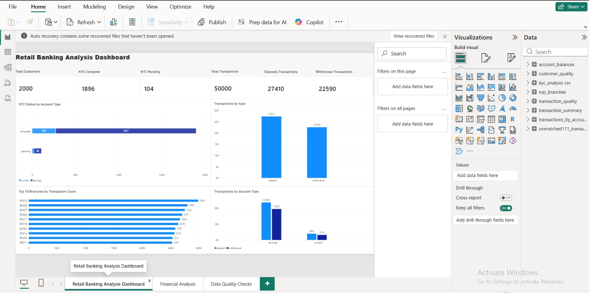
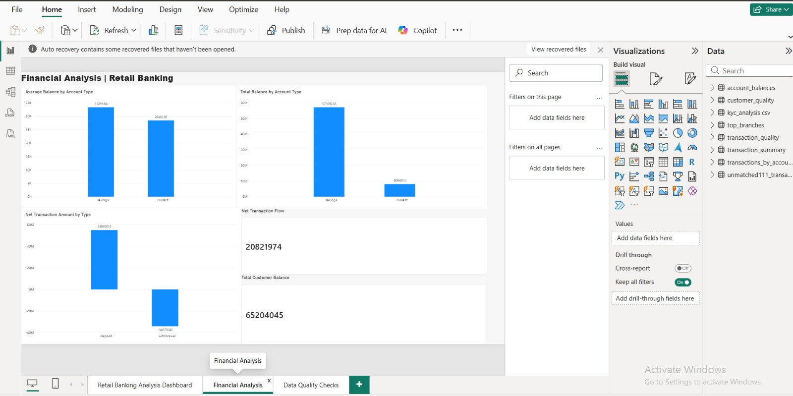
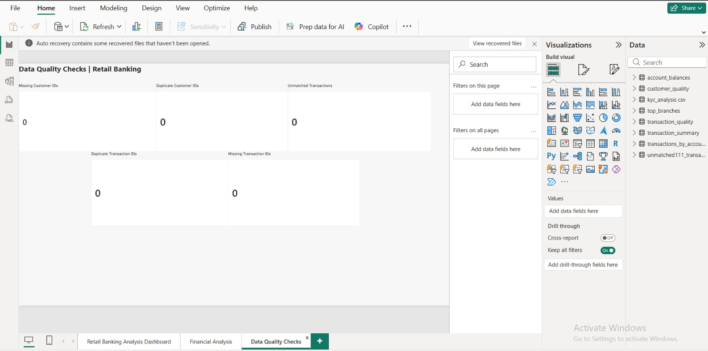

# retail-banking-sql-excel-powerbi
# Retail Banking Analysis | SQL, Excel & Power BI

## About the Project

This is a personal portfolio project created to practice data analysis and banking reporting using SQL, Excel and Power BI.

I worked with an existing retail banking dataset containing 2,000 customers and 50,000 transactions.

The main goal was to analyze customer information, banking transactions and account balances, and to check the consistency of the results across different tools.

## Tools Used

-SQLite / DB Browser for SQLite — querying and aggregating data

-Microsoft Excel — Pivot Tables, formulas and result validation

-Power BI Desktop — dashboards and financial reporting

-GitHub — project documentation and file sharing

## SQL Analysis

I used SQL to analyze:

Customer distribution and KYC status

Deposits and withdrawals

Transaction activity by branch

Account balances by account type

Data quality, including missing IDs, duplicate IDs and unmatched transactions

SQL concepts practiced include JOIN, LEFT JOIN, GROUP BY, ORDER BY, COUNT, SUM, AVG and DISTINCT.

## Excel Analysis

I used Excel to recreate and validate selected SQL results.

The workbook includes:

Pivot Tables

COUNTIF and COUNTIFS

SUMIF and AVERAGEIF

XLOOKUP and VLOOKUP

IF formulas

Balance reconciliation between Excel and SQL

## Power BI Report

The report contains three pages:

1. Retail Banking Analysis Dashboard

Customer KPIs, KYC status, transactions by type, top branches and transaction activity by account type.

2. Financial Analysis

Average and total customer balances, deposit and withdrawal amounts, and net transaction flow.

3. Data Quality Checks

Checks for missing and duplicate customer/transaction IDs, as well as transactions without a matching customer.

## Key Findings

The dataset contains 2,000 customers and 50,000 transactions.

94.8% of customers have completed KYC verification.

There are 27,410 deposit transactions and 22,590 withdrawal transactions.

Savings accounts have a higher average balance than current accounts.

Total customer balances amount to 65,204,045 in dataset units.

All five data quality checks performed returned zero issues.

## Project Files

banking_analysis1.sql — SQL queries

Retail_Banking_Excel_Analysis.xlsx — Excel analysis and validation

Retail_Banking_Analysis.pbix — Power BI report

Three dashboard screenshots in JPEG format

## Dataset Source

The original practice dataset was obtained from:

https://github.com/aadyaa04/retail-banking-sql-powerbi

Credit for the original dataset and source project belongs to its creator.

My personal project focuses on SQL analysis, Excel validation and the Power BI reports I developed for learning purposes.

## What I Learned

This project helped me understand how to use SQL, Excel and Power BI together for banking reporting.

I also practiced comparing results between different tools, checking data quality and presenting financial information in a clear format.
